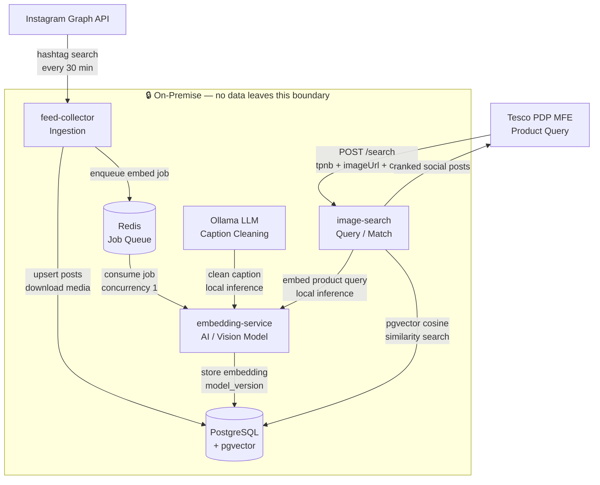

# FNF Social Analyser — Architecture

> Surface relevant F&F social media posts on the Tesco PDP to provide authentic social proof, powered by vision-language AI matching.

---

## 1. Problem Statement

Tesco F&F Clothing has a growing body of user-generated content (UGC) on Instagram — real customers wearing F&F products. This content drives purchase intent but is disconnected from the product discovery experience on tesco.com.

The challenge is matching unstructured social posts (images + captions with hashtags) to specific Tesco products (identified by TPNB) — without requiring influencers to tag products explicitly.

---

## 2. System Overview

Three loosely coupled services with clear, non-overlapping responsibilities:



| Service | Responsibility | Scaling concern |
|---|---|---|
| **feed-collector** | Ingest social posts, download media, enqueue embedding jobs | I/O bound — rate-limited by Instagram API |
| **embedding-service** | Generate vision-language embeddings (image + text) | CPU/GPU bound — model inference |
| **image-search** | Match product queries to social posts | Read-heavy — pgvector similarity search |

Services communicate asynchronously (feed-collector → embedding-service via job queue) and synchronously (image-search → embedding-service via HTTP). This decoupling means the embedding model can be swapped without touching ingestion or search logic.

### Data Privacy

**No social post data, captions, images, or embeddings leave the system boundary.**

All AI inference runs fully on-premise:
- **Caption cleaning** — Ollama runs the LLM locally; no text is sent to OpenAI or any external API
- **Vision-language embeddings** — the CLIP/SigLIP model runs locally via PyTorch; no images are sent to a cloud AI provider
- **Vector search** — pgvector runs inside the self-hosted PostgreSQL instance

The only outbound traffic is:
- Reads from the Instagram Graph API (inbound social content)
- Reads from the Tesco product CDN (product images for search queries)

---

## 3. Key Design Decisions

### 3.1 Ingestion is asynchronous, search is synchronous

Embedding generation is slow (LLM caption cleaning + vision model inference). Doing this synchronously at ingest time would block the ingestion pipeline. Instead:

- feed-collector saves the post and enqueues an embed job
- embedding-service processes jobs sequentially via a Redis queue (BullMQ)
- image-search generates a fresh product embedding at query time (acceptable latency — ~200–500ms)

**Why BullMQ with concurrency: 1?**

Ollama (local LLM) processes **one request at a time** — it is single-threaded by design. Sending concurrent caption-cleaning requests causes:
- Requests queuing inside Ollama with unpredictable timeouts
- Memory pressure from multiple simultaneous model inference sessions
- Socket hang-ups when the embedding-service waits too long for a response

BullMQ with `concurrency: 1` enforces strictly sequential processing — one post is fully embedded (caption cleaned + image encoded + vector saved) before the next job starts. Jobs that fail are retried with exponential backoff, and failed jobs are retained for inspection (`removeOnFail: 50`).

### 3.2 Two-tier matching

Not all posts carry product signals. The matching strategy is tiered by confidence:

```
Tier 1 — Direct (exact, free)
  Instagram product tag match (product_id)
  Product URL found in caption

Tier 2 — Semantic (approximate, expensive)
  Embed product image + caption → query vector
  pgvector cosine similarity against stored post embeddings
```

Tier 1 always wins — it's zero-cost and guaranteed correct. Tier 2 handles the long tail of untagged posts using vision-language AI.

### 3.3 Embeddings are combined image + text

A post embedding encodes both what the post **shows** (image) and what it **says** (cleaned caption). The same strategy is applied to the product query. This gives the similarity search two signals to work with rather than one.

```
post_embedding  = avg(encode_image(post_photo), encode_text(clean_caption))
query_embedding = avg(encode_image(product_photo), encode_text(product_caption))
similarity      = cosine(post_embedding, query_embedding)
```

### 3.4 Vision model is decoupled from services

The embedding model is configured via `CLIP_MODEL_ID` — swapping it requires only a config change, a service restart, and a re-backfill. No code changes. This was a deliberate choice to allow iterating on model quality independently of product and ingestion logic.

Models evaluated:
- `patrickjohncyh/fashion-clip` — fashion-specific, lower dims
- `google/siglip-so400m-patch14-384` — better image-text alignment (SigLIP loss)
- `laion/CLIP-ViT-L-14-laion2B-s32B-b82K` — strong general model, large training set

### 3.5 Caption cleaning before embedding

Raw Instagram captions are noisy — hashtags, emojis, mentions, ad disclosures, and irrelevant text dominate. A local LLM (Ollama) cleans the caption to extract only fashion-relevant content before embedding. This improves text embedding quality significantly.

### 3.6 pgvector over a dedicated vector database

pgvector (HNSW index) gives approximate nearest-neighbour search within the existing PostgreSQL instance. At prototype scale this avoids operational complexity of a separate vector database (Pinecone, Weaviate, etc.) with no meaningful performance trade-off.

---

## 4. Data Model

Four core entities:

```
posts                   — raw ingested social post
  └── post_embeddings   — vision-language vector per post (1:1)

instagram_tokens        — long-lived Graph API access token

products (future)       — F&F product catalogue
  └── post_product_links (future) — curated post ↔ product associations
```

**Key design choices:**
- `image_path` stores only the filename, not the full path — the base path is constructed from an env variable, making the data portable across environments
- `model_version` in `post_embeddings` is written from the embedding service response, not from consumer config — the DB always reflects the actual model that generated the vector
- Embeddings from different models cannot coexist in the same table — column type is fixed-dimension `VECTOR(n)`. Switching models requires truncating and re-backfilling

---

## 5. Ingestion Pipeline

```
Instagram Graph API (hashtag search, every 30 min)
        │
        ▼
Fetch posts → deduplicate → persist to DB
        │
        ▼
Download media to local storage
        │
        ▼
Enqueue embedding job (async, Redis)
        │
        ▼ (sequential, one at a time)
Clean caption (LLM) + encode image + text (vision model)
        │
        ▼
Store embedding vector in DB
```

Sequential processing (concurrency: 1) is intentional — the LLM and vision model are single-threaded; parallel inference causes memory pressure and socket hang-ups.

---

## 6. Search Pipeline

```
POST /search { tpnb, imageUrl, caption, productUrl? }
        │
        ├─ Tier 1: Direct match (product tag or URL in caption)
        │         → return immediately, no AI involved
        │
        └─ Tier 2: Semantic match
                  Embed product (image + caption) → query vector
                  Cosine similarity search (pgvector HNSW)
                  Return ranked results above similarity threshold
```

---

## 7. Token Lifecycle

Instagram long-lived tokens expire after 60 days. The system manages this automatically:

1. Token validated and seeded to DB on every startup
2. Daily cron checks expiry — refreshes proactively 7 days before expiry
3. New token written back to `.env` and DB after successful refresh
4. All Graph API calls use the token from DB, never from env directly

---

## 8. Current Limitations

| Limitation | Impact | Path forward |
|---|---|---|
| Small dataset (~1.5k posts) | Semantic matches are low quality — insufficient variety | Grow via more hashtags, longer ingestion window |
| Generic post captions | Text embedding carries little signal | Caption cleaning helps but can't recover from truly empty captions |
| Studio vs social image domain gap | Product photos (white background) vs real-world photos are visually different | Fine-tuned fashion model; or product-specific training data |
| No product catalogue | Tier 1 matching depends on Instagram product tags being set | Integrate Tesco xAPI product catalogue |
| Single platform | Instagram only | TikTok, Pinterest support via `ISocialPlatformClient` interface |

---

*Last updated: September 2026*
