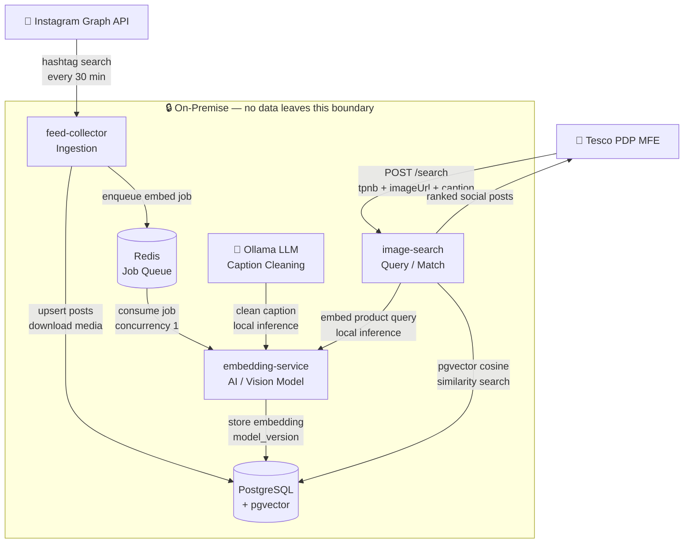

<div align="center">

# 🛍️ F&F Social Analyser

**AI-powered social media matching for F&F Clothing**

Surface authentic Instagram posts on the Tesco PDP — matched to products using local vision-language AI, with zero data leaving your infrastructure.

[](https://nodejs.org)
[](https://python.org)
[](https://postgresql.org)
[](https://github.com/pgvector/pgvector)
[](https://redis.io)
[](https://ollama.com)
[](./LICENSE)

</div>

---

## ✨ What is this?

F&F Clothing has thousands of real customers sharing their outfits on Instagram. This system automatically finds those posts and matches them to the exact Tesco products being worn — using local AI that runs entirely on-premise.

```
Customer posts photo wearing F&F jacket
            ↓
System ingests + embeds the post (image + caption)
            ↓
Tesco PDP sends product details
            ↓
System returns matching social posts ranked by visual similarity
```

No cloud AI APIs. No data egress. Everything runs locally.

---

## 🏗️ Architecture



---

## 🧩 Services

| Service | Language | Role |
|---|---|---|
| [`feed-collector`](./feed-collector/) | Node.js / TypeScript | Ingest Instagram posts, download media, queue embedding jobs |
| [`embedding-service`](./embedding-service/) | Python / FastAPI | Clean captions (LLM) + generate vision-language embeddings |
| [`image-search`](./image-search/) | Node.js / TypeScript | Match Tesco products to social posts via pgvector similarity |

---

## 🔍 How Matching Works

### Tier 1 — Direct Match _(zero cost, exact)_

If a post has an Instagram product tag or the product URL appears in the caption — it's a guaranteed match. Score: `1.0`.

### Tier 2 — Semantic Match _(AI-powered)_

The product image and caption are embedded using a local vision-language model. pgvector finds the most similar social posts using cosine similarity.

```
product image + caption
        ↓
embed via FashionCLIP / SigLIP / LAION CLIP (local, on-device)
        ↓
512/768/1152-dim vector
        ↓
pgvector HNSW cosine similarity search
        ↓
ranked social posts (score: 0.0 – 1.0)
```

---

> **📊 Result quality scales with data**
>
> Semantic search matches products against your locally ingested social posts. The more posts collected, the better the variety and accuracy of results. With a small dataset (&lt;2k posts) matches will be limited — run the feed-collector continuously to grow the index over time.

---

## 🚀 Quick Start

### Prerequisites

| Tool | Purpose |
|---|---|
| Docker | PostgreSQL + Redis |
| Node.js 22+ | feed-collector, image-search |
| Python 3.11+ | embedding-service |
| Ollama | Local LLM for caption cleaning |
| Yarn | Node.js package manager |

### 1. Clone and configure

```bash
git clone <repo-url>
cd fnf-social-analyser
cp .env.example .env
# Fill in your Instagram credentials in .env
```

### 2. Start infrastructure

```bash
docker compose up -d
```

### 3. Start embedding service

```bash
cd embedding-service
python3 -m venv .venv && source .venv/bin/activate
pip install -r requirements.txt
python main.py
# Port read from EMBEDDING_SERVICE_PORT in root .env
# First run downloads the vision model (~1–3GB)
```

### 4. Start Ollama

```bash
ollama pull llama3.2:3b
ollama serve
```

### 5. Start feed-collector

```bash
cd feed-collector && yarn install && yarn dev
```

### 6. Start image-search

```bash
cd image-search && yarn install && yarn dev
```

### 7. Trigger first ingestion

```bash
curl -X POST http://localhost:3000/__dev/sync
```

### 8. Search

```bash
curl -s -X POST http://localhost:3001/search 
  -H "Content-Type: application/json" 
  -d '{
    "tpnb": "323951665",
    "imageUrl": "https://digitalcontent.api.tesco.com/v2/media/ghs/xxx/image.jpeg",
    "caption": "F&F Faux Leather Funnel Neck Oversized Fit Jacket in Black",
    "productUrl": "https://www.tesco.com/shop/en-GB/clothing/products/323951665"
  }' | python3 -m json.tool
```

> For full setup instructions see [SETUP.md](./SETUP.md)

---

## 🤖 Vision Models

The embedding model is configurable via `CLIP_MODEL_ID` — no code changes required to switch.

| Model | Dims | Notes |
|---|---|---|
| `laion/CLIP-ViT-L-14-laion2B-s32B-b82K` | 768 | Current — large training set, strong general model |
| `google/siglip-so400m-patch14-384` | 1152 | Better image-text alignment (SigLIP loss function) |
| `patrickjohncyh/fashion-clip` | 512 | Fashion-specific — trained on Instagram + e-commerce pairs |

> Switching models requires truncating `post_embeddings` and running `yarn backfill:embeddings`

---

## 🔒 Privacy First

**All AI inference runs on-premise. No social post data, captions, images, or embeddings are sent to any external API.**

| Component | Where it runs |
|---|---|
| Caption cleaning (LLM) | Ollama — local |
| Vision-language embedding | PyTorch — local |
| Vector similarity search | pgvector — local PostgreSQL |

The only outbound traffic is reading posts from the Instagram Graph API and product images from the Tesco CDN.

---

## 📁 Project Structure

```
fnf-social-analyser/
├── feed-collector/       # Node.js ingestion service
├── embedding-service/    # Python AI embedding service
├── image-search/         # Node.js search API
├── scripts/              # DB backup, restore, backfill
├── media/                # Downloaded post images (gitignored)
├── docs/                 # API curl examples
├── docker-compose.yml    # PostgreSQL + Redis
├── .env.example          # Environment template
├── ARCHITECTURE.md       # System architecture
└── SETUP.md              # Full setup guide
```

---

## 📜 Scripts

| Command | Description |
|---|---|
| `yarn backfill:embeddings` | Generate embeddings for all posts missing them |
| `yarn db:backup` | Backup PostgreSQL to `backups/` |
| `yarn db:restore` | Restore from a backup file |


---

## 📚 Documentation

| Document | Description |
|---|---|
| [SETUP.md](./SETUP.md) | Full setup and configuration guide |
| [ARCHITECTURE.md](./ARCHITECTURE.md) | System architecture and design decisions |
| [feed-collector/README.md](./feed-collector/README.md) | Ingestion service docs |
| [embedding-service/README.md](./embedding-service/README.md) | AI embedding service docs |
| [image-search/README.md](./image-search/README.md) | Consumer search API docs |
| [docs/API_CURL.md](./docs/API_CURL.md) | cURL examples for all endpoints |
| [TROUBLESHOOT.md](./TROUBLESHOOT.md) | Common issues — SSL, Redis, embedding errors, Instagram API |
| [docs/101.md](./docs/101.md) | Beginner's guide — vision models, embeddings, cosine similarity |

---

<div align="center">

*Built with ❤️ for Tesco F&F Clothing*

</div>

