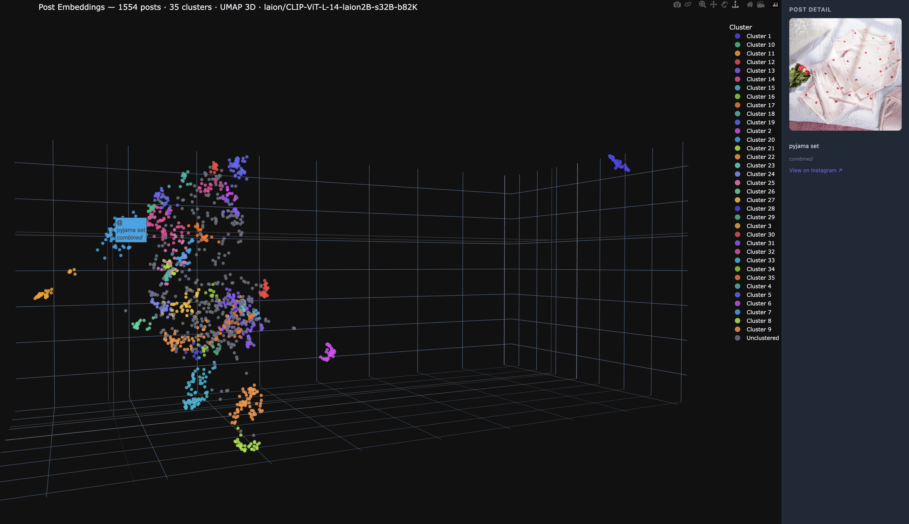

# embedding-service

> Local vision-language embedding service. Converts social post images and captions into dense vectors for semantic similarity search. All inference runs on-premise — no data leaves the system.



---

## Responsibilities

1. **Caption cleaning** — strips hashtags, emojis, mentions, ad disclosures from raw Instagram captions using a local LLM (Ollama)
2. **Vision-language embedding** — encodes image + cleaned caption into a combined vector using a CLIP-compatible model
3. **Model versioning** — returns the exact HuggingFace model ID with every embedding response so consumers write the correct `model_version` to the DB

Called by:
- **feed-collector** — at ingest time to embed new posts (via BullMQ worker)
- **image-search** — at search time to embed the product query

---

## Setup

```bash
cd embedding-service
python3 -m venv .venv
source .venv/bin/activate
pip install -r requirements.txt
```

### First run — model download

On first startup the vision model is downloaded from HuggingFace (~0.5–3.5GB depending on model). Once downloaded, set `HF_HUB_OFFLINE=1` in root `.env` for faster offline startup.

---

## Running

```bash
python main.py
```

Port is read from `EMBEDDING_SERVICE_PORT` in root `.env` — no need to pass it manually.

Verify:

```bash
curl -s http://localhost:${EMBEDDING_SERVICE_PORT}/health | python3 -m json.tool
```

---

## API

### `GET /health`

Returns the active model and device.

```json
{
  "status": "ok",
  "clip_model": "laion/CLIP-ViT-L-14-laion2B-s32B-b82K",
  "clip_device": "mps",
  "ollama_model": "llama3.2:3b"
}
```

---

### `POST /embed/combined`

Full pipeline — clean caption + encode image + text. This is the primary endpoint used by consumers.

**Request:**

```json
{
  "caption": "obsessed with this jacket 🖤 wearing size 10 black faux leather bomber #fandfclothing #ootd",
  "image_path": "/absolute/path/to/media/instagram/17888291706617649.jpg"
}
```

`image_path` accepts a local file path or a remote `http(s)` URL.

**Response:**

```json
{
  "embedding": [0.023, -0.041, ...],
  "dimensions": 768,
  "source": "combined",
  "clean_caption": "black faux leather bomber jacket size 10",
  "model_version": "laion/CLIP-ViT-L-14-laion2B-s32B-b82K"
}
```

| Field | Description |
|---|---|
| `embedding` | Dense vector — dimensions depend on active model |
| `dimensions` | Vector size (e.g. 512, 768, 1152) |
| `source` | `combined` if both image and text encoded, `text_only` if image unavailable |
| `clean_caption` | Caption after LLM cleaning |
| `model_version` | Exact HuggingFace model ID — write this to `post_embeddings.model_version` |

---

### `POST /embed/text`

Text-only embedding.

```json
{ "text": "black faux leather bomber jacket" }
```

```json
{ "embedding": [...], "dimensions": 768 }
```

---

### `POST /embed/image`

Image-only embedding. Accepts local path or URL.

```json
{ "image_path": "/path/to/image.jpg" }
```

```json
{ "embedding": [...], "dimensions": 768 }
```

---

### `POST /caption/clean`

Cleans a raw Instagram caption. Useful for debugging what the LLM extracts.

```json
{ "caption": "obsessed 🖤 #fandfclothing #ootd ad gifted https://tesco.com/fnf" }
```

```json
{
  "clean_caption": "black faux leather jacket",
  "original_caption": "obsessed 🖤 #fandfclothing #ootd ad gifted https://tesco.com/fnf"
}
```

---

## Configuration

All configuration is read from the root `.env` file.

| Variable | Default | Description |
|---|---|---|
| `CLIP_MODEL_ID` | `laion/CLIP-ViT-L-14-laion2B-s32B-b82K` | HuggingFace model ID for vision-language encoding |
| `CLIP_DEVICE` | auto-detected | `mps` (Apple Silicon), `cuda` (GPU), `cpu` |
| `OPENAI_BASE_URL` | `http://localhost:11434/v1` | Ollama base URL |
| `OPENAI_API_KEY` | `ollama` | Use `ollama` for local Ollama |
| `LLM_MODEL` | `llama3.2:3b` | Ollama model for caption cleaning |
| `LLM_TIMEOUT` | `30` | LLM request timeout in seconds |
| `HF_HUB_OFFLINE` | `0` | Set to `1` after model downloaded for offline startup |
| `NODE_EXTRA_CA_CERTS` | — | Absolute path to Tesco CA cert. Single SSL source of truth — `clip_service.py` derives `SSL_CERT_FILE`, `REQUESTS_CA_BUNDLE`, and `CURL_CA_BUNDLE` from it at runtime. Required on Tesco network. |

---

## Switching Models

Change `CLIP_MODEL_ID` in root `.env` to any HuggingFace CLIP-compatible model:

| Model | Dims | Notes |
|---|---|---|
| `laion/CLIP-ViT-L-14-laion2B-s32B-b82K` | 768 | Current — large training set, strong general model |
| `google/siglip-so400m-patch14-384` | 1152 | Better image-text alignment (SigLIP loss) |
| `patrickjohncyh/fashion-clip` | 512 | Fashion-specific training |

> ⚠️ Switching models requires truncating `post_embeddings` and re-running `yarn backfill:embeddings` — embeddings from different models are incompatible.

---

## Privacy

All inference runs locally — no captions, images, or embeddings are sent to external APIs. Ollama and the vision model run entirely on-premise.
